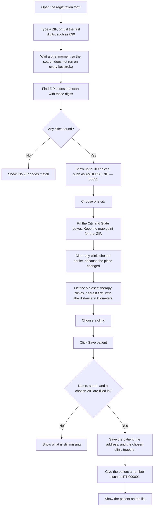
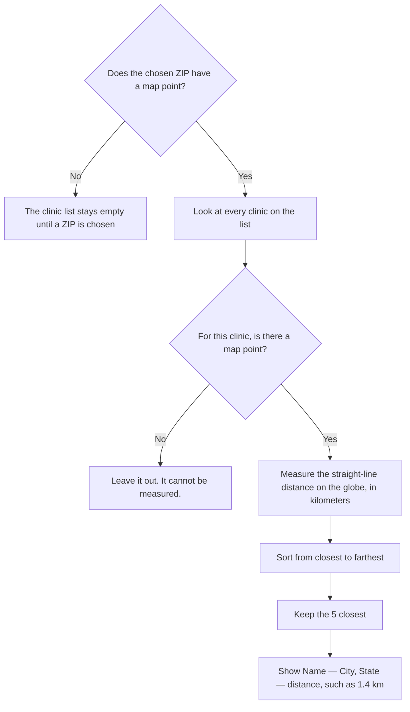
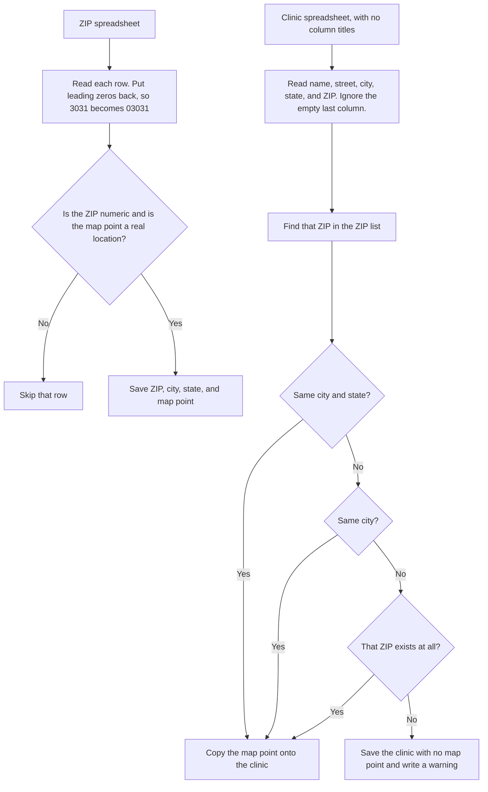
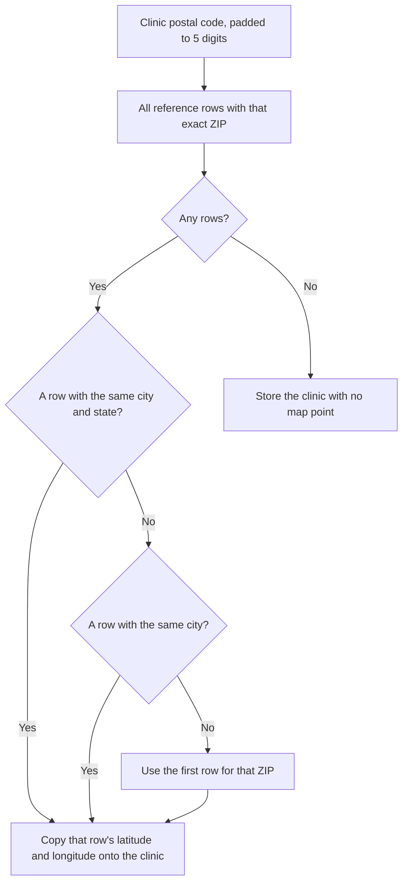

# Patient Address POC

Registry for patient addresses. Typing a ZIP prefix fills city, state, and coordinates from the ZIP reference table. The form then lists the nearest physical therapy clinics by straight-line distance. There is no fuzzy-search library and no city-name search on the address field.

## How it works

These charts follow the same path a person uses on the form. Boxes are steps. Diamonds are decisions.

### Registering a patient



Typing letters does nothing. Only digits are kept, and at most 5. Choosing a different ZIP starts the clinic list over.

### Choosing the closest clinic



Distance uses the Haversine formula and an earth radius of 6371 km. A clinic whose ZIP was not in the ZIP spreadsheet has no map point, so it never appears in this list. It is still stored.

### Loading the spreadsheets once

Search does not open the Excel files. `npm run seed` copies them into the database first. After that, every lookup uses the database.



Running the load again replaces the ZIP list and the clinic list. Patients already saved keep their address. Their clinic link is cleared, because the old clinic rows are replaced.

## How to run

PostgreSQL is published on **port 5433** so it does not collide with a database already listening on 5432.

```bash
cd patient-address-poc
docker compose up -d --wait

cd backend
cp .env.example .env
npm install
npm run seed
npm run start:dev
```

In a second terminal:

```bash
cd patient-address-poc/frontend
npm install
npm run dev
```

Open http://localhost:5173. The Vite dev server proxies `/api` to http://localhost:3000.

`npm run seed` reads the Excel files in `backend/data`:

- `zip-codes-database-FREE.xls` into `zip_code`. The first row is a documentation banner; the script uses the `City`, `State`, `Latitude`, and `Longitude` header cells and treats the first column as the ZIP. `Classification` and `Population` are ignored. ZIP codes are padded to 5 digits (`501` becomes `00501`).
- `Master PT Location List_06.18.2026.xlsx` into `pt_location`. That sheet has no header row. Columns are name, street, city, state, and postal code. Coordinates come from the ZIP table for that postal code. A clinic whose ZIP is missing is stored with null coordinates and listed in the seed log.

```bash
cd backend
npm run seed
```

## Try it

1. In **ZIP**, type `030`. The dropdown lists cities whose ZIP starts with those digits, such as `AMHERST, NH — 03031`. You do not need all 5 digits.
2. Choose a row. City and state fill their input boxes. Latitude and longitude are stored with the address and are not shown as fields.
3. Open **Closest PT location**. The options look like `Apple Therapy Services LLC — Amherst, NH — 1.4 km`.
4. Save the patient. The roster shows the name, address, and clinic.

## API

| Method | Path | Purpose |
| --- | --- | --- |
| `GET` | `/api/address/search?q=030` | Up to 10 ZIPs that start with `030`, with city and coordinates. |
| `GET` | `/api/address/search?q=03031` | Same prefix match; a full ZIP returns that code. |
| `GET` | `/api/pt/nearest?lat=42.86&lng=-71.60&limit=5` | Nearest PT clinics, street, and `distanceKm`. |
| `POST` | `/api/patient` | Create a patient, nested address, and optional `ptLocationId`. |
| `GET` | `/api/patient` | List patients with address and clinic. |

Create body:

```json
{
  "firstName": "Ada",
  "middleName": "M",
  "lastName": "Lovelace",
  "dateOfBirth": "1990-05-01",
  "gender": "female",
  "ptLocationId": 1,
  "address": {
    "addressLine1": "100 N Crescent Dr",
    "city": "Beverly Hills",
    "state": "CA",
    "postalCode": "90210",
    "latitude": 34.100517,
    "longitude": -118.41463
  }
}
```

`gender` is `male`, `female`, or `other`. The MRN is assigned as `PT-000001` from the patient id. `patientName` is first, middle, and last joined with spaces.

## How the system is implemented

### Runtime

The UI is a React 18 + Vite app. Axios calls `/api`, and the Vite dev server proxies that prefix to NestJS on port 3000. NestJS uses a global `api` prefix, CORS, and a validation pipe that strips unknown fields.

PostgreSQL 15 runs in Docker and is published on host port **5433**. TypeORM connects with `DB_HOST`, `DB_PORT`, `DB_USER`, `DB_PASS` (or `DB_PASSWORD`), and `DB_NAME`. `synchronize: true` creates and updates tables from the entities for this POC. Decimal columns use a transformer so latitude and longitude come back as numbers rather than strings.

The Excel files are not read during search. `npm run seed` loads them once into `zip_code` and `pt_location`. Autocomplete and nearest-clinic queries hit those tables. Converting the workbooks to JSON would not speed up the form.

### Tables

`zip_code` is the reference set: `zip`, `city`, `state`, `latitude`, `longitude`. `idx_zip_code_zip` indexes `zip`, which is what the prefix lookup uses.

`pt_location` is a clinic: name, street, city, state, postal code, and nullable latitude/longitude. Coordinates are copied from the matching ZIP during seed. A clinic whose ZIP is missing from the reference file is stored with null coordinates and excluded from nearest results.

`address` is the address saved with a patient. `idx_address_postal_code` indexes `postal_code`.

`patient` stores name, optional date of birth and gender (`male`, `female`, `other`), status, and soft delete. `address_id` and `pt_location_id` are single foreign keys (`@ManyToOne` + `@JoinColumn` + `@RelationId`). Deleting a clinic sets `pt_location_id` to null. Indexes: `idx_patients_email`, `idx_patients_dedup` (`last_name`, `first_name`, `date_of_birth`), `idx_patients_status`, `idx_patients_not_deleted`, `idx_patients_address`. On create, the service writes the address and patient in one transaction, then sets `patient_number` to `PT-` plus the id padded to 6 digits. `patient_name` is first, middle, and last joined with spaces.

### Seed

`backend/src/seed/seed.ts` uses SheetJS (`xlsx`) only.

The ZIP workbook's first row is a documentation banner. Columns 1–4 of that row are the real headers (`City`, `State`, `Latitude`, `Longitude`). The ZIP itself is column 0. SheetJS reads `03031` as the number `3031`, so every code is passed through `String(value).padStart(5, '0')`. Rows with a non-numeric ZIP or non-finite coordinates are skipped. Inserts run in batches of 1000. The log line is `Inserted X zip codes, skipped Y rows.`

The PT workbook has no header. Each row is an array: 0 name, 1 street, 2 city, 3 state, 4 postal code. The trailing empty column is ignored. Postal codes are padded the same way, and state is trimmed and uppercased. After the ZIP rows are parsed, each clinic looks up its postal code. A city-and-state match wins, then a city match, then the first row for that ZIP. Missing matches log a warning and keep null coordinates. The log line is `Inserted X PT locations, Y without coordinates.`

Re-seeding deletes `pt_location` and then `zip_code` before inserting. Existing patients keep their address; their clinic link is cleared by the foreign key.

### ZIP autofill

The address field accepts digits only, at most 5. The input waits 400 ms, then calls `GET /api/address/search?q=`.

The service accepts 1 to 5 digits and runs `zip LIKE '030%'`, ordered by ZIP then city, limited to 10 rows. A letter query returns an empty list. A full 5-digit code is the same prefix match, so `03031` returns Amherst, NH. The response is `{ zip, city, state, lat, lng }`.

Choosing a row stores city, state, ZIP, latitude, and longitude and clears the previously selected clinic, because the nearest list depends on the new coordinates. The form shows one ZIP field. City and state are separate input boxes filled from the selected ZIP. Saving the patient remounts the ZIP field so the next entry starts empty.

### Nearest clinics

`GET /api/pt/nearest` loads every `pt_location` row. At this POC size that is about 150 clinics. Rows with null coordinates are dropped. Distance is the Haversine formula in `backend/src/address/geo.ts` with earth radius 6371 km, rounded to 3 decimal places. Results sort by distance, then name, and return the requested limit (default 5, maximum 50): `{ id, name, addressLine1, city, state, postalCode, distanceKm }`.

The dropdown label is `Name — City, State — 1.4 km`. The selected id is sent as `ptLocationId` on `POST /api/patient`.

### Patient list

`GET /api/patient` left-joins address and clinic. An optional `q` filters patient name or MRN with `ILIKE`. That filter is separate from ZIP lookup.

## Technical reference

Two different rules deal with “more than one ZIP.” Typing in the form is a prefix search and returns many rows for the person to choose. Loading clinics picks one map point when several saved rows share the same 5-digit code.

### Finding a ZIP among many codes

The form keeps digits only, at most 5, then waits 400 ms and calls `GET /api/address/search?q=`. Anything that is not 1 to 5 digits returns an empty list. The typed value is not padded. `303` searches codes that start with `303` (`30300`–`30399`). It does not become `03031`. The leading zero has to be typed.

The query is a left-anchored match on the indexed `zip` column:

```sql
SELECT zip, city, state, latitude, longitude
FROM zip_code
WHERE zip LIKE '030%'
ORDER BY zip ASC, city ASC
LIMIT 10;
```

`idx_zip_code_zip` can serve that pattern because the wildcard is only at the end. There is no city-name search and no fuzzy score.

What the person sees:

| Typed | Matches | What comes back |
| --- | --- | --- |
| `0` | every ZIP starting with 0 | the first 10, ordered by ZIP then city |
| `030` | `03000`–`03099` | up to 10 rows, starting at `03031` Amherst, NH |
| `0303` | `03030`–`03039` | a shorter list, still ordered by ZIP |
| `03031` | that code only | `AMHERST`, `NH`, latitude `42.8696`, longitude `-71.611` |
| `amherst` | none | `[]` |

Each database row is one result. If the reference file has two cities for one 5-digit code, both can appear, still ordered by ZIP then city, and still inside the limit of 10. Choosing a row is what fills City, State, and the hidden latitude and longitude. The form does not guess among those rows.

### Choosing one map point when a clinic ZIP matches several rows

This happens only while seeding, and only for a clinic. The clinic sheet has a postal code and no latitude or longitude. The seed builds a map from ZIP code to every reference row with that code, then picks one row in this order:

1. Same city and same state. City compare ignores case. State is already uppercased.
2. Otherwise, same city only.
3. Otherwise, the first reference row stored for that ZIP.
4. If the ZIP is absent, latitude and longitude stay null and the seed logs a warning. Example from this file: `01875`, Neuro-Rehab Associates Inc, Tewksbury, MA.



Clinics that share a ZIP therefore share one map point: the ZIP centroid, not the street address. Two Amherst clinics at `03031` both sit on `42.8696, -71.611`.

### Calculating the nearest clinics

After a ZIP is chosen, the form calls:

`GET /api/pt/nearest?lat=42.8696&lng=-71.611&limit=5`

`lat` must be from -90 to 90 and `lng` from -180 to 180. `limit` defaults to 5 and must be an integer from 1 to 50.

The service loads all clinic rows (about 150 in this file). It does not use a bounding box or a database distance function. For each clinic:

1. Drop the row if latitude or longitude is null. A null would become `0` in arithmetic and would be ranked as if the clinic were on the equator.
2. Compute the great-circle distance with the Haversine formula. Earth radius `R` is 6371 km. Angles are converted from degrees to radians.

```text
dLat = (lat2 - lat1) * π / 180
dLon = (lon2 - lon1) * π / 180
a    = sin²(dLat / 2) + cos(lat1) * cos(lat2) * sin²(dLon / 2)
km   = 6371 * 2 * atan2(√a, √(1 - a))
```

3. Round to 3 decimal places: `Math.round(km * 1000) / 1000`. The dropdown then shows one decimal, so `1.394` is labeled `1.4 km`.
4. Sort by `distanceKm` ascending. If two distances are equal, sort by clinic name.
5. Return the first `limit` rows: `id`, `name`, `addressLine1`, `city`, `state`, `postalCode`, `distanceKm`.

Worked check. The patient point `42.86, -71.60` and the Amherst centroid `42.8696, -71.611` are 1.394 km apart. Both Amherst clinics that use `03031` get that same distance, so the name order decides which of those two is listed first. A Bedford clinic on a different ZIP centroid is farther, about 10.3 km, and is listed after the closer towns.

This distance is straight-line on the globe. It is not driving distance, not drive time, and not a road network.
